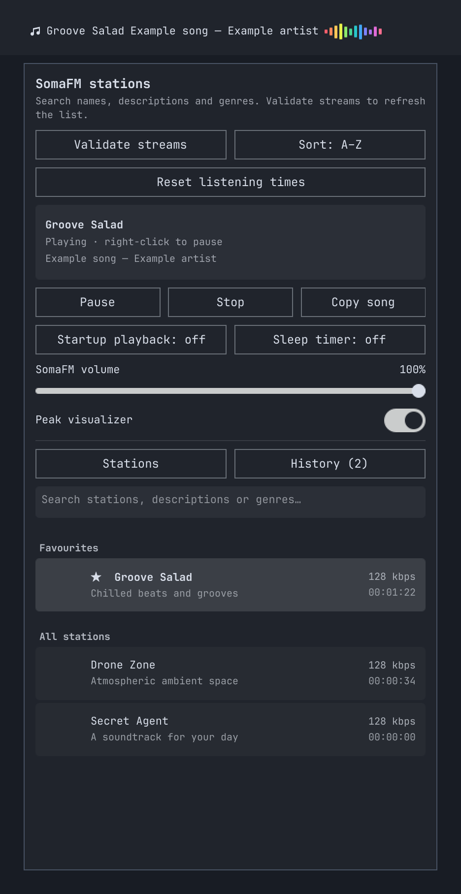

# SomaFM widget



[SomaFM](https://somafm.com/) offers a free streaming radio service. If you enjoy
listening, please consider [supporting SomaFM](https://somafm.com/support/) to help
keep it running.

## Install

Install from the Git repository with:

```bash
omarchy plugin add https://github.com/mozchops/omarchy-somafm.git --enable
```
The widget will appear in the bar; playback starts when you select a
station. To remove it from the bar temporarily, run
`omarchy plugin disable nick.somafm`; enable it again with
`omarchy plugin enable nick.somafm --section right`.

Requirements: Python 3, FFmpeg, `pw-play` from PipeWire, `python-dbus`,
`python-gobject`, and `wl-clipboard` (for copying song information).

## Uninstall

Remove the widget and its installed plugin files with:

```bash
omarchy plugin remove nick.somafm
```

The station cache, favorites, listening totals, and song history in
`~/.config/omarchy/somafm-stations.json` remain available if you reinstall.

## Features

The bar widget fetches SomaFM's current channel and playlist
catalog when you click **Validate streams** in the selector. Opening the
selector fetches the catalog automatically only when no verified stations are
loaded; after that, click the button whenever you want to recheck it. The
widget checks each highest-quality playlist and uses the available stream
with the greatest reported bitrate, retaining verified alternatives for
fallback. If a connection drops or stalls, playback retries up to six times
with increasing delays, rotating through those alternatives. The popup
distinguishes buffering, playing, paused, reconnecting, stopped, and failed
states; after failure, click **Play** to retry.
Select a station to play it; right-click
the bar widget to pause or resume. Desktop media keys and MPRIS-compatible
controllers can also play, pause, stop, and adjust this widget's volume.
The popup contains the peak-visualizer
toggle, you can change the colour palette of the visualiser by clicking on it, 
There is also an independent SomaFM stream-volume slider.
The slider affects only this widget's audio, not system volume. The popup
opens below the bar widget.
Right-click a station to toggle its favorite status. Favorites appear
first; the sort button switches between
alphabetical and most-played order, based on accumulated listening time.
Listening totals accumulate across playback sessions and are saved with the
station cache; the alphabetical/most-played sort choice is saved there too.
**Reset listening times** clears those totals.
The search field filters station names, descriptions, and genres, matching all
typed words. Press Enter to play the first matching station.

The last selected station is remembered without automatically playing it.
Enable **Startup playback** to resume that station when the widget next loads;
this is off by default. The **Sleep timer** button cycles through 15, 30, 60,
and 90 minutes, then off. It stops playback when the time expires, including
if playback is paused or reconnecting; manually stopping also cancels it.

**History** shows the last 30 observed songs, newest first, with their station
and time. Repeated metadata updates for the same song do not create duplicates.
Click a history entry or **Copy song** to copy its title and artist.

Validated station catalog and favorite station records are saved in
`~/.config/omarchy/somafm-stations.json`; opening the selector uses that cache,
and **Validate streams** refreshes it. Favorite IDs are retained across refreshes, 
with matching favorites updated to the newest stream details.
The same file stores song history, the last station, and the startup-playback
choice. The sleep timer is session-only.
Each station uses its official SomaFM artwork thumbnail in the selector; the
bar displays the station name without artwork.

FFmpeg decodes
the selected stream to PCM for PipeWire playback and calculates the live
visualizer levels. While a station is playing, the helper requests that
station's current-song JSON every 20 seconds. It does not refresh the catalog
in the background.

Network requests use fixed HTTPS SomaFM endpoints with bounded response sizes
and timeouts. Unverified playlist entries are omitted. Visualizer, palette,
and stream-volume preferences are kept in Quickshell persistent properties.

## Development checks

Run the focused streaming, MPRIS, and widget checks with:

```bash
dbus-run-session -- python -m unittest discover -s tests -v
```

The widget integration check uses the installed Omarchy shell in a Wayland
session, with hidden windows, isolated configuration and D-Bus, and simulated
audio and clipboard helpers. It is skipped when that runtime is unavailable.

## License

This plugin is distributed under the [MIT License](LICENSE).
